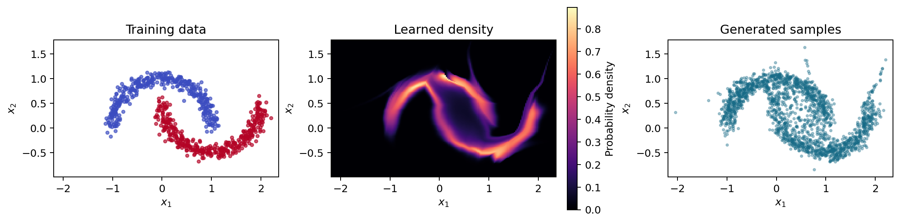
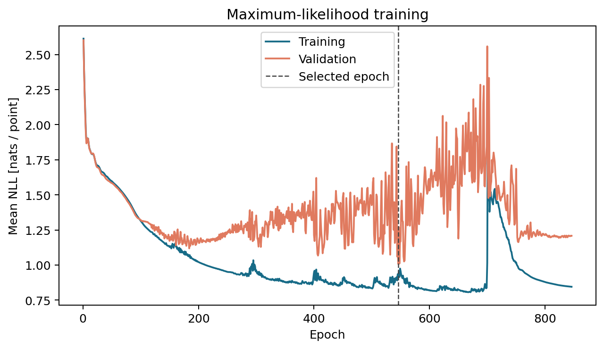
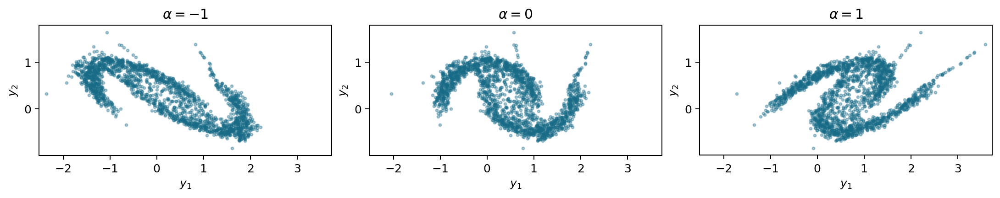

# Normalising Flows on Two Moons

Density estimation with affine coupling flows implemented in PyTorch.

**Peijing Pang · Cambridge MPhil in Data Intensive Science · M2 Deep Learning coursework (2026)**

A sequence of invertible transformations maps a standard Gaussian to a two-moons distribution, with exact likelihood evaluation through the change-of-variables formula. Composing the learned flow with a volume-preserving shear gives a family of related distributions without retraining.



## What the project covers

- Affine coupling layers with explicit forward maps, inverses and analytic log-determinants.
- Maximum-likelihood training, validation-based checkpoint selection and test-set evaluation.
- Numerical comparisons of analytic, autograd and finite-difference Jacobians.
- Sampling and density evaluation under invertible shear transformations.
- An idealised operation count for the specified architecture.

The example generates its own synthetic data. It learns a probability density over coordinates; the moon labels are used only to colour plots. Course CSVs can also be supplied externally. See [Data](docs/data.md) for the generator and input format.

## Quick start

Requires Python 3.11 or newer. Run from the repository root:

```bash
python -m venv .venv
source .venv/bin/activate
python -m pip install -r requirements.txt
python -m pip install --no-deps -e .
python scripts/train_flow.py --output-dir outputs/two_moons
```

The command saves the selected weights, learning curves, metrics, samples and figures. [RUNNING.md](RUNNING.md) covers notebooks, external data, a short execution check and loading a trained model.

## Example results

The recorded synthetic experiment uses 800 training, 100 validation and 100 test points, noise standard deviation 0.08, six coupling layers and hidden width 64. Data and model seeds are both 42, with separate random streams. Training uses full-batch Adam, a maximum of 4,000 epochs and patience of 300 epochs. The initial learning rate of 0.003 was selected using validation NLL; the comparison and training conventions are described in [Methods](docs/method.md).

| Split | Mean NLL [nats / point] |
|---|---:|
| Training | 0.9137 |
| Validation | 1.0071 |
| Test | 0.9898 |

The selected model is from epoch **546**; early stopping ended the run at epoch **846**. The flow follows the broad curved structure but also assigns probability between the moons. These are results for this synthetic configuration, not evidence of performance on physical observations.



The flow contains **2,712 parameters**. On 800 training points, the maximum float32 data round-trip error is **1.07 × 10⁻⁶**. On 32 points in float64, the maximum inverse log-determinant discrepancy is **3.55 × 10⁻¹⁵** against autograd and **3.10 × 10⁻⁸** against central finite differences. These checks test the transformation identities, separately from the quality of the density fit. Exact settings and machine-readable metrics are in [example_summary.json](assets/example_summary.json).

## Shear transformations

For $g_\alpha(x_1,x_2)=(x_1+\alpha x_2,x_2)$, the Jacobian determinant is one. The transformed density is therefore $p_\alpha(y)=p_X(g_\alpha^{-1}(y))$. The panels below apply different shear coefficients to the same generated samples.



## Repository guide

| Path | Purpose |
|---|---|
| `src/moonflow/models.py` | Affine coupling layers and the complete flow |
| `src/moonflow/training.py` | Optimisation, validation selection and checkpoint I/O |
| `src/moonflow/data.py` | Synthetic data generation and external CSV loading |
| `src/moonflow/checks.py` | Invertibility, Jacobian and operation-count checks |
| `src/moonflow/transforms.py` | Shear maps, samples and transformed densities |
| `src/moonflow/pipeline.py` | Complete experiment and output metadata |
| `src/moonflow/plotting.py` | Density, training and shear figures |
| `scripts/train_flow.py` | Command-line training entry point |
| `notebooks/` | Mathematical checks and a shorter training walkthrough |
| `tests/` | Mathematical references, training and end-to-end output checks |

## Validation

```bash
python -m pip install -r requirements-dev.txt
python -m pytest
```

The tests cover inverse identities, known Gaussian densities, shear Jacobians, gradient propagation, checkpoint selection and agreement between saved outputs and model evaluations. See [Numerical validation](docs/validation.md) for details.

Scientific, software and teaching sources are listed in [References](docs/references.md).
